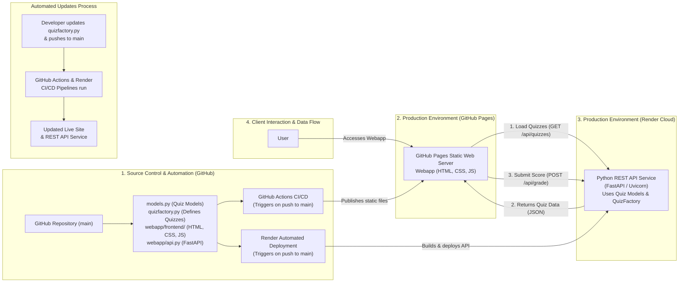
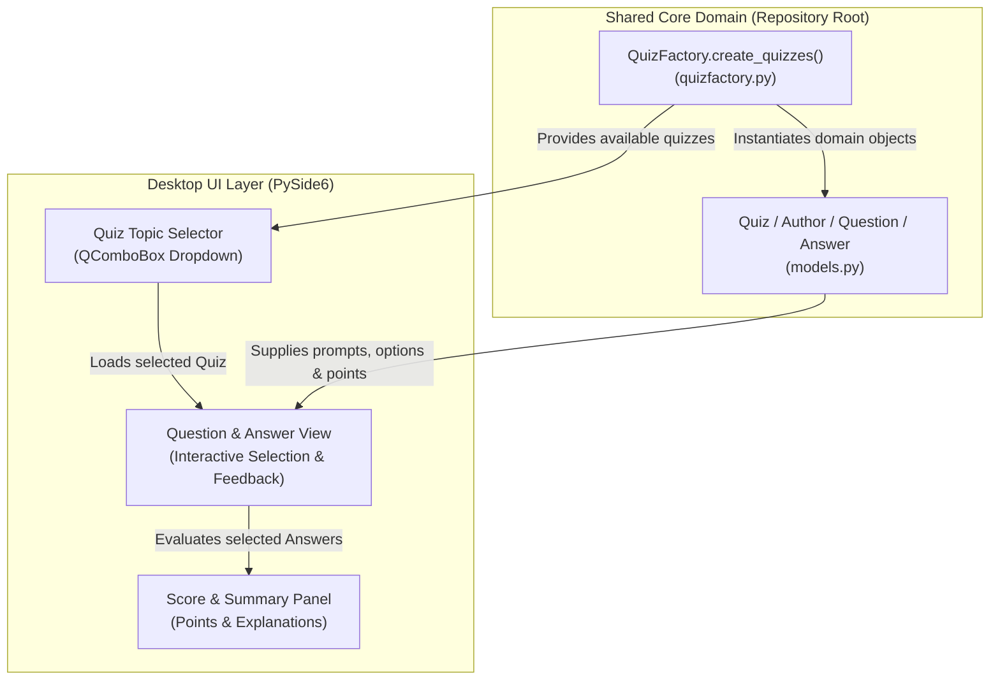

# Python Quiz WebApp hosted on GitHub Pages

Quiz REST API hosted on a Render Python API service for distributing quiz configurations.

## Description

A configurable Quiz App using object-oriented design to simultaneously store multiple quiz definitions and display them in a PySide6 GUI or web frontend. Users select a quiz topic from a dropdown. Quiz definitions come from `QuizFactory.create_quizzes()`, keeping `models.py` unchanged and separating domain models from quiz configuration. Without affecting the GUI or models, `create_quizzes()` could in the future be extended to load quizzes from CSV, JSON, or an external database.

## Models (`models.py`)

Quizzes are defined in `models.py`, where `Quiz` is composed of an `Author` (instructor), a list of `Question` objects, and each `Question` holds a list of `Answer` choices.

[View the Quiz Web App](https://genericworker.github.io/quiz_project/)

## Architecture & Automated Deployment




## Python Representation

```python
from models import Answer, Author, Question, Quiz


class QuizFactory:
    """Factory responsible for instantiating unique authors, questions, and complete quizzes."""

    @staticmethod
    def create_question(
        prompt: str,
        options: list[tuple[str, bool]],
        explanation: str = "",
        category: str = "General",
        points: int = 10,
    ) -> Question:
        answers = [Answer(text=text, is_correct=is_correct) for text, is_correct in options]
        return Question(
            prompt=prompt,
            answers=answers,
            explanation=explanation,
            category=category,
            points=points,
        )

    @staticmethod
    def create_quizzes(source: str | None = None) -> dict[str, Quiz]:
        # Currently builds sample quizzes in-memory; can later read from CSV or a database.
        _ = source

        prof_whitehead = Author(name="Prof. Michael Whitehead", email="mwhitehead@dccc.edu")
        prof_vance = Author(name="Dr. Jonathan Vance", email="jvance@dccc.edu")

        python_quiz = Quiz(
            title="Python Fundamentals",
            description="Assess your knowledge of core Python syntax, data types, and flow control.",
            instructor=prof_whitehead,
            welcome_message="Welcome to the Python Fundamentals quiz!",
            questions=[
                QuizFactory.create_question(
                    prompt="Which data structure is immutable in Python?",
                    options=[("list", False), ("tuple", True), ("dict", False)],
                    explanation="Tuples cannot be modified after creation.",
                    category="Python Basics",
                    points=10,
                ),
            ],
        )

        oop_quiz = Quiz(
            title="Object-Oriented Basics",
            description="Test your understanding of classes, attributes, and composition.",
            instructor=prof_vance,
            welcome_message="Welcome to the Object-Oriented Basics quiz!",
            questions=[
                QuizFactory.create_question(
                    prompt="What does a class define?",
                    options=[
                        ("A blueprint for instances", True),
                        ("A database table", False),
                        ("A network socket", False),
                    ],
                    explanation="A class acts as a blueprint from which objects are instantiated.",
                    category="OOP",
                    points=10,
                ),
            ],
        )

        return {
            python_quiz.title: python_quiz,
            oop_quiz.title: oop_quiz,
        }
```

## FastAPI Service (`webapp/api.py`)

`webapp/api.py` exposes `QuizFactory.create_quizzes()` and the domain models over HTTP so the static frontend on GitHub Pages (or local port `5500`) can load quizzes and submit answers for grading:

- **Path & Factory Integration:** Inserts the project root and `webapp/` into `sys.path` so `models` and `quizfactory` resolve reliably, and calls `QuizFactory.create_quizzes()` on requests without mutating domain instances.
- **CORS Configuration:** Configures `CORSMiddleware` for `https://genericworker.github.io`, `http://localhost:5500`, and `http://127.0.0.1:5500` across `GET`, `POST`, and `OPTIONS` requests.
- **Endpoints:**
  - `GET /api/quizzes` — Returns available quiz titles (`list[str]`).
  - `GET /api/quizzes/{quiz_title}` — Returns `QuizBundleOut` (metadata, total points, and questions/answers), or `404` if the quiz does not exist.
  - `POST /api/grade` — Accepts `quiz_title` and `selections` (`dict[str, int | None]` mapping stringified question index to 0-based answer index), scores points, handles skipped answers as `[Skipped]`, and returns `GradeResponse` (`score`, `total_possible_points`, `percentage`, and per-question `items`).

## Desktop App Architecture (PySide6)



### Desktop App Notes

- **Shared Core Reuse:** The PySide6 desktop GUI uses the exact same `models.py` and `QuizFactory.create_quizzes()` classes as the FastAPI backend—no duplicated quiz definitions.
- **Topic Selection & Grading:** Selecting a topic from the dropdown loads that `Quiz` instance into the UI, tracks chosen `Answer` options per `Question`, and computes total points and explanations on submission.
- **Independent Workflow:** Because `models.py` and `quizfactory.py` stay decoupled from the UI layer, you can update quizzes in `QuizFactory` or refine PySide6 widgets without breaking the web app or REST API.
- **GitHub Codespaces Limitation:** When running in GitHub Codespaces, you cannot launch the PySide6 desktop app directly in a local desktop window unless you use a remote terminal/display forwarding setup. Use the FastAPI backend and web frontend inside Codespaces, and run the desktop GUI on a local desktop machine.

## Adding or Modifying Quizzes

Because quiz definitions live in `QuizFactory.create_quizzes()` inside `quizfactory.py` rather than in `models.py` or the UI, you can add or update quizzes in one place and reuse the same models across `pytest`, the PySide6 desktop app, and the FastAPI web app.

1. **Edit `QuizFactory.create_quizzes()` in `quizfactory.py`:**
   - Add a new `Quiz` (with an `Author`, `title`, `description`, `welcome_message`, and list of `Question` objects built via `QuizFactory.create_question(...)`) or update existing questions, answer options, explanations, categories, or point values.
   - Keep `models.py` untouched so data structures remain decoupled from quiz content.
   - Return the updated dictionary mapping each quiz title to its `Quiz` instance.

2. **Run unit tests (`pytest`) from the project root:**
   - Install dependencies (`pip install -r requirements-dev.txt`) and run `pytest` from the project root to verify quiz counts, authors, questions, answer keys, and scoring logic:
     ```bash
     pytest
     ```
   - Fix any failing assertions or factory typos before moving to browser or API checks.

3. **Start the local FastAPI backend and static frontend:**
   - **Terminal 1 — FastAPI / Uvicorn (port `8000`):**
     ```bash
     python -m uvicorn webapp.api:app --reload --reload-dir . --port 8000
     ```
   - **Terminal 2 (or Live Server) — Static frontend (port `5500`):**
     ```bash
     cd webapp/frontend
     python -m http.server 5500
     ```

4. **Test the webapp locally end-to-end:**
   - Verify `http://127.0.0.1:8000/api/quizzes` returns your new or updated quiz payload.
   - Open `http://127.0.0.1:5500` in your browser, select the new or modified quiz from the topic dropdown, answer questions, submit for grading (`POST /api/grade`), and confirm scores, explanations, and edge cases behave as expected.

5. **Update production with any changes — commit, push, and retest live:**
   - Stage, commit, and push your changes to `main` to trigger GitHub Actions (GitHub Pages) and Render automated deployment.
   - Once both deployments finish, retest the live GitHub Pages site (`https://genericworker.github.io/quiz_project/`) against the Render API to confirm the updates are live.

## Testing with the PySide6 Desktop App

You can validate new or updated quizzes directly through the PySide6 desktop GUI without starting Uvicorn or a static HTTP server. Note that in GitHub Codespaces this is not possible unless using a remote terminal/display forwarding setup—run it on a local desktop environment instead:

1. **Run from the project root:** Open your terminal at the project root so imports resolve `models.py` and `quizfactory.py` cleanly (activating `.venv` first if using one on your local machine).
2. **Launch the PySide6 desktop entry module:** Run `python quizapp.py` from the project root.
3. **Verify quiz content and grading:** Pick the added or modified quiz from the topic selector, answer questions, submit for grading, and check prompts, answer options, scores, and explanations.
4. **Keep UI and domain layers decoupled:** If a widget or layout issue appears during desktop testing, fix it in the PySide6 UI code while keeping `models.py` and `quizfactory.py` intact.