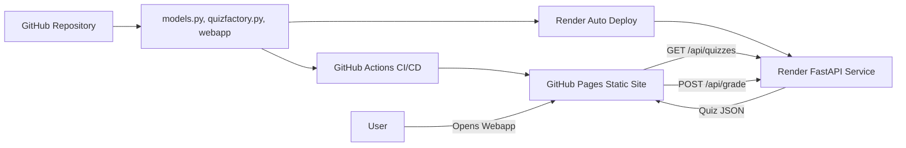
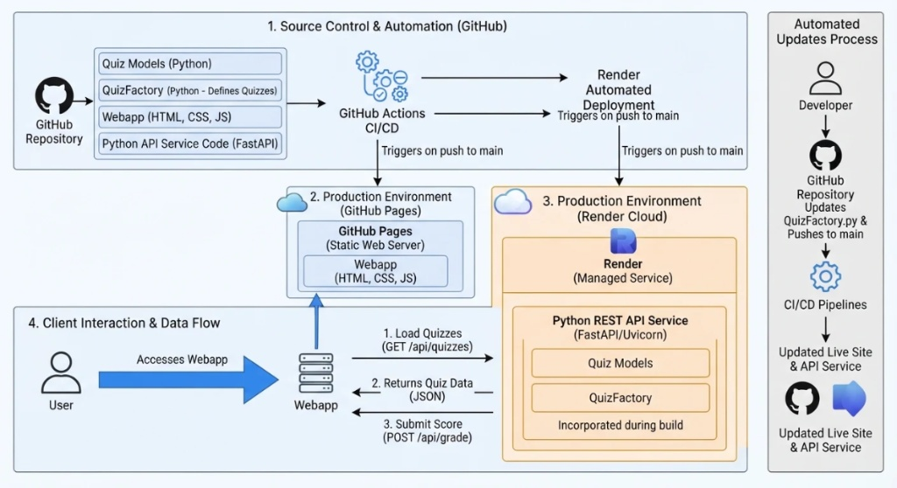
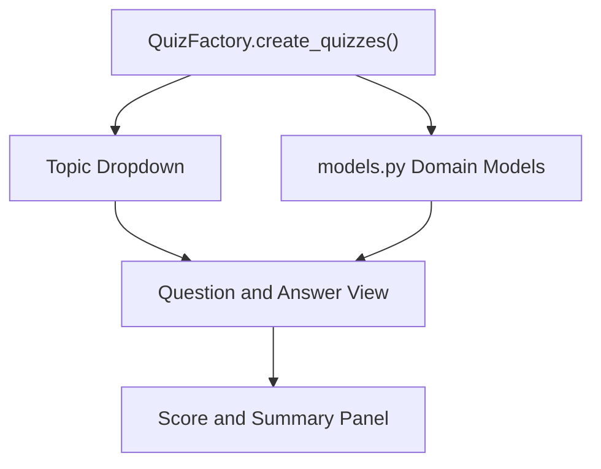

# Python Quiz WebApp hosted on GitHub Pages

Quiz REST API hosted on a Render Python API service for distributing quiz configurations.

## Description

A configurable online Quiz Service using object-oriented design to simultaneously store multiple quiz definitions and display them in a web frontend hosted on GitHub/Azure Cloud and a Python FastAPI Rest service hosted on Render. A PySide6 Ptyhon Deskop app is provided for local use and testing. 

Users select a quiz topic from a dropdown. Quiz definitions are provisioned from `QuizFactory.create_quizzes()`, keeping `models.py` unchanged and separating domain models from quiz configuration. Without affecting the GUI or models. Additioned or modifications the quizzes from QuizFactory, when checked into GitHub become nearlly immediately  available to the website via GitHub Pages built-in CI/CD deployement and integrations.  

## Models (`models.py`)

Quizzes are defined in `models.py`, where `Quiz` is composed of an `Author` (instructor), a list of `Question` objects, and each `Question` holds a list of `Answer` choices.

[View the Quiz Web App](https://genericworker.github.io/quiz_project/)

## Architecture and Automated Deployment





## Python Representation

```python
from models import Answer, Author, Question, Quiz


class QuizFactory:
    """Factory responsible for instantiating unique authors, questions, and complete quizzes."""

    @staticmethod
    def create_question(
        prompt: str,
        options: list[tuple[str, bool]],
        explanation: str = "",
        category: str = "General",
        points: int = 10,
    ) -> Question:
        answers = [Answer(text=text, is_correct=is_correct) for text, is_correct in options]
        return Question(
            prompt=prompt,
            answers=answers,
            explanation=explanation,
            category=category,
            points=points,
        )

    @staticmethod
    def create_quizzes(source: str | None = None) -> dict[str, Quiz]:
        # Currently builds sample quizzes in-memory; can later read from CSV or a database.
        _ = source

        prof_whitehead = Author(name="Prof. Michael Whitehead", email="mwhitehead@dccc.edu")
        prof_vance = Author(name="Dr. Jonathan Vance", email="jvance@dccc.edu")

        python_quiz = Quiz(
            title="Python Fundamentals",
            description="Assess your knowledge of core Python syntax, data types, and flow control.",
            instructor=prof_whitehead,
            welcome_message="Welcome to the Python Fundamentals quiz!",
            questions=[
                QuizFactory.create_question(
                    prompt="Which data structure is immutable in Python?",
                    options=[("list", False), ("tuple", True), ("dict", False)],
                    explanation="Tuples cannot be modified after creation.",
                    category="Python Basics",
                    points=10,
                ),
            ],
        )

        oop_quiz = Quiz(
            title="Object-Oriented Basics",
            description="Test your understanding of classes, attributes, and composition.",
            instructor=prof_vance,
            welcome_message="Welcome to the Object-Oriented Basics quiz!",
            questions=[
                QuizFactory.create_question(
                    prompt="What does a class define?",
                    options=[
                        ("A blueprint for instances", True),
                        ("A database table", False),
                        ("A network socket", False),
                    ],
                    explanation="A class acts as a blueprint from which objects are instantiated.",
                    category="OOP",
                    points=10,
                ),
            ],
        )

        return {
            python_quiz.title: python_quiz,
            oop_quiz.title: oop_quiz,
        }
```

## FastAPI Service (`webapp/api.py`)

`webapp/api.py` exposes `QuizFactory.create_quizzes()` and the domain models over HTTP so the static frontend on GitHub Pages, local port `5500`, or forwarded Codespaces ports can load quizzes and submit answers for grading:

- **Path and Factory Integration:** Inserts the project root and `webapp/` into `sys.path` so `models` and `quizfactory` resolve reliably, and calls `QuizFactory.create_quizzes()` on requests without mutating domain instances.
- **CORS Configuration:** Configures `CORSMiddleware` for `https://genericworker.github.io`, `http://localhost:5500`, `http://127.0.0.1:5500`, and forwarded Codespaces origins across `GET`, `POST`, and `OPTIONS` requests.
- **Endpoints:**
  - `GET /api/quizzes` — Returns available quiz titles (`list[str]`).
  - `GET /api/quizzes/{quiz_title}` — Returns `QuizBundleOut` (metadata, total points, and questions/answers), or `404` if the quiz does not exist.
  - `POST /api/grade` — Accepts `quiz_title` and `selections` (`dict[str, int | None]` mapping stringified question index to 0-based answer index), scores points, handles skipped answers as `[Skipped]`, and returns `GradeResponse` (`score`, `total_possible_points`, `percentage`, and per-question `items`).

## Desktop App Architecture (PySide6)



### Desktop App Notes

- **Shared Core Reuse:** The PySide6 desktop GUI uses the exact same `models.py` and `QuizFactory.create_quizzes()` classes as the FastAPI backend—no duplicated quiz definitions.
- **Topic Selection and Grading:** Selecting a topic from the dropdown loads that `Quiz` instance into the UI, tracks chosen `Answer` options per `Question`, and computes total points and explanations on submission.
- **Independent Workflow:** Because `models.py` and `quizfactory.py` stay decoupled from the UI layer, you can update quizzes in `QuizFactory` or refine PySide6 widgets without breaking the web app or REST API.
- **GitHub Codespaces Limitation:** When running in GitHub Codespaces, you cannot launch the PySide6 desktop app directly in a local desktop window unless you use a remote terminal/display forwarding setup. But you can use the FastAPI backend and web frontend inside Codespaces without issue or run the desktop GUI. 

## Adding or Modifying Quizzes

Because quiz definitions live in `QuizFactory.create_quizzes()` inside `quizfactory.py` rather than in `models.py` or the UI, you can add or update quizzes in one place and reuse the same models across `pytest`, `project.py`, the PySide6 desktop app, and the FastAPI web app. For complete environment setup instructions, see `SETUP.md`.

1. **Edit `QuizFactory.create_quizzes()` in `quizfactory.py`:**
   - Add a new `Quiz` (with an `Author`, `title`, `description`, `welcome_message`, and list of `Question` objects built via `QuizFactory.create_question(...)`) or update existing questions, answer options, explanations, categories, or point values.
   - Keep `models.py` untouched so data structures remain decoupled from quiz content.
   - Return the updated dictionary mapping each quiz title to its `Quiz` instance.

2. **Run unit tests (`pytest`) from the project root:**
   - Install dependencies (`pip install -r requirements-dev.txt`) and run `pytest` from the project root (`quiz_project`) to verify quiz counts, authors, questions, answer keys, and scoring logic:
     ```bash
     pytest
     ```
   - Fix any failing assertions or factory typos before moving to browser or API checks.

3. **Start the local FastAPI backend and static frontend from the project root:**
   - **Terminal 1 — FastAPI / Uvicorn (port `8000`):**
     ```bash
     python -m uvicorn webapp.api:app --reload --reload-dir . --port 8000
     ```
   - **Terminal 2 — Static frontend (port `5500`, anchored at project root):**
     ```bash
     python -m http.server 5500 --directory webapp/frontend
     ```

4. **Test the webapp end-to-end:**
   - **Local machine:** Verify `http://127.0.0.1:8000/api/quizzes` returns your quiz payload, then open `http://127.0.0.1:5500` in your browser.
   - **GitHub Codespaces (`cs50.dev`):** Open the **Ports** tab in VS Code, ensure both port `5500` and port `8000` are forwarded (with port `8000` set to **Public** if needed), and click **Open in Browser** on port `5500`. `webapp/frontend/app.js` automatically maps the `-5500.` forwarded host to `-8000.`.
   - Select the new or modified quiz from the topic dropdown, answer questions, submit for grading (`POST /api/grade`), and confirm scores, explanations, and edge cases behave as expected.

5. **Update production with any changes — commit, push, and retest live:**
   - Stage, commit, and push your changes to `main` to trigger GitHub Actions (GitHub Pages) and Render automated deployment.
   - Once both deployments finish, retest the live GitHub Pages site (`https://genericworker.github.io/quiz_project/`) against the Render API to confirm the updates are live.

## Testing with the PySide6 Desktop App

You can validate new or updated quizzes directly through the PySide6 desktop GUI without starting Uvicorn or a static HTTP server. Note that in GitHub Codespaces this is not possible unless using a remote terminal/display forwarding setup or you can run desktop environment locally:

1. **Run from the project root:** Open your terminal at the project root so imports resolve `models.py` and `quizfactory.py` cleanly (activating `.venv` first if using one on your local machine).
2. **Launch the PySide6 desktop entry module:** Run `python quizapp.py` from the project root.
3. **Verify quiz content and grading:** Pick the added or modified quiz from the topic selector, answer questions, submit for grading, and check prompts, answer options, scores, and explanations.
4. **Keep UI and domain layers decoupled:** If a widget or layout issue appears during desktop testing, fix it in the PySide6 UI code while keeping `models.py` and `quizfactory.py` intact.

## Root Entry Point and Automated Grading (`project.py` & `test_project.py`)

For automated grading, `project.py` and `test_project.py` reside in the repository root alongside `requirements.txt` and `pyproject.toml`.

### Environment Setup

1. Activate your virtual environment from the project root in PowerShell:
   ```powershell
   .venv\Scripts\Activate.ps1
   ```
2. Install dependencies:
   ```powershell
   pip install -r requirements.txt
   ```
   *(If you use a separate `requirements-dev.txt`, install that as well before running `pytest`.)*
3. Ensure `[tool.pytest.ini_options]` in `pyproject.toml` discovers root and `tests` files and registers the `live` marker:
   ```toml
   [tool.pytest.ini_options]
   pythonpath = ["."]
   testpaths = [".", "tests"]
   addopts = "-ra"
   markers = [
       "live: marks tests that hit the live Render deployment over the network",
   ]
   ```

### Root Entry Point (`project.py`)

`project.py` defines `main()` and top-level functions that exercise the quiz catalog, FastAPI routes in-process via `TestClient` (no local server required), and optional live requests when `base_url` is passed:

- `list_available_quizzes(base_url=None)` — fetches available quiz titles from `/api/quizzes`.
- `fetch_quiz_bundle(quiz_title, base_url=None)` — retrieves quiz metadata, total points, and questions/answers from `/api/quizzes/{quiz_title}`.
- `grade_quiz_answers(quiz_title, selections, base_url=None)` — posts answer selections to `/api/grade` and returns score, percentage, and item breakdown.

Run `project.py` directly from the project root:

```powershell
python project.py
```

### Running `test_project.py` (`pytest`)

`test_project.py` in the project root contains `test_*` functions matching the top-level functions in `project.py`.

#### Default Offline Tests (Autograding and Fast Local Checks)

Runs in-memory via `TestClient` without needing a running server, external network access, or live Render requests:

```powershell
pytest test_project.py -v
```

#### Optional `"live"` Tests Against Render

Live tests are decorated with `@pytest.mark.live` and skipped by default unless `RUN_LIVE_RENDER_TESTS=1` is set. Set the environment variable, run the `"live"` test(s) against `https://quiz-api-genericworkerquiz-project.onrender.com`, and clear the variable afterward if you want later runs in the same shell to stay offline:

```powershell
$env:RUN_LIVE_RENDER_TESTS="1"
pytest -m live test_project.py -v
Remove-Item Env:RUN_LIVE_RENDER_TESTS -ErrorAction SilentlyContinue
```

*(Initial requests to Render after idle spin-down may take extra time while the instance wakes up.)*


# Setup & Local Development

## 1. Extracting the Project (Codespaces / Zip Archive)

If you are setting up the repository from a downloaded zip archive (`quiz_project-main.zip`) without `git` access:

```bash
mkdir -p quiz_project _extract_tmp
unzip -o quiz_project-main.zip -d _extract_tmp
INNER_DIR=$(find _extract_tmp -mindepth 1 -maxdepth 1 -type d | head -n 1)
mv "$INNER_DIR"/* "$INNER_DIR"/.[!.]* quiz_project/ 2>/dev/null || true
rm -rf _extract_tmp
cd quiz_project
```

## 2. Dependencies

From the project root (`quiz_project`), install development and runtime dependencies (which pull in `requirements.txt` via `-r`):

```bash
pip install -r requirements-dev.txt
```

If you only need runtime dependencies without dev/test packages:

```bash
pip install -r requirements.txt
```

If you use a virtual environment on Windows PowerShell, create and activate it first:

```powershell
python -m venv .venv
.\.venv\Scripts\Activate.ps1
pip install -r requirements-dev.txt
```

## 3. Package & Test Verification

Verify that `webapp.api` imports cleanly and run `pytest` from the project root:

```bash
python -c "import webapp.api; print(webapp.api.app)"
pytest
```

If `webapp` needs `__init__.py` to be treated as a package and does not already have one, create it once rather than on every run:

- **Linux / macOS / Codespaces:** `touch webapp/__init__.py`
- **Windows PowerShell:** `New-Item -ItemType File -Path webapp\__init__.py -Force`

## 4. Running Locally (API on Port `8000` + Frontend on Port `5500`)

Make sure `webapp/frontend/app.js` resolves `API_BASE_URL` for your current host (`http://127.0.0.1:8000` on `127.0.0.1` or `localhost`, the corresponding `-8000.` forwarded host when served from a `-5500.` Codespaces hostname, and your Render URL otherwise).

### Terminal 1 — FastAPI Backend (Port `8000`)

Start the FastAPI server from the project root:

```bash
python -m uvicorn webapp.api:app --reload --reload-dir . --port 8000
```

### Terminal 2 — Static Frontend (Port `5500`)

Stay in the project root (`quiz_project`) and serve `webapp/frontend` on port `5500` using `--directory` so your terminal stays anchored at the root:

```bash
python -m http.server 5500 --directory webapp/frontend
```

## 5. Opening `index.html` in the Browser

- **Local machine:** Open `http://127.0.0.1:5500` (or use Live Server / **Open in Browser** on `webapp/frontend/index.html`).
- **GitHub Codespaces (`cs50.dev`):**
  1. Open the **Ports** tab in the bottom panel of VS Code.
  2. Confirm both port `5500` and port `8000` are listed and forwarded (set port `8000` visibility to **Public** if the browser blocks cross-port requests).
  3. Click **Open in Browser** (globe icon) next to port `5500`.
  4. Avoid opening `index.html` as a `file://` URL or starting Live Server on port `5500` while `python -m http.server 5500` is already running (which triggers `OSError: [Errno 98] Address already in use`).