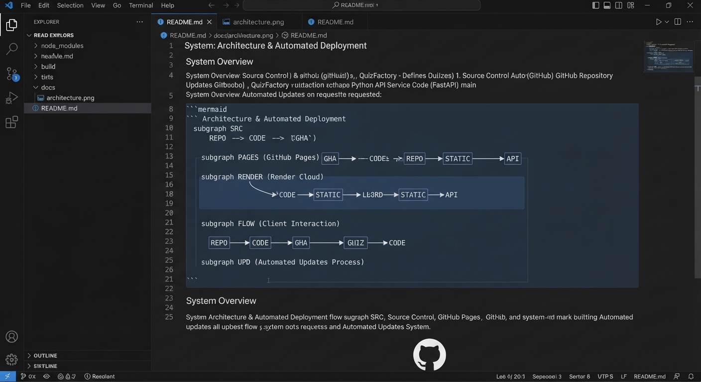

  # Python Reusable Open QuizApp 
    #### Video Demo:  <URL HERE>
    #### Description:
    #### An configurable Quiz App using object-oriented design to simultaneously store multiple quiz definitions and display them in a
    #### in pleasant PySide6 GUI.  The user can select the quiz topic through a drop down. Actual quiz definitions are inserted from a QuizFactory class that serves up the list of configured quizzes while the models class is not modified, separating the models from the actual quiz configuration. QuizFactory serves up the list of quizzes with to the GUI through its createQuizzes(). Without affecting the GUI or the models classes, create_quizzes method could easily be enhanced to obtain quizzes from csv,json, or database totally outside the system. This separation of concerns architecture extendes to the GUI where instea other GUI ar
    ### Quizzes are defined using the models.py module which includes
    ###  the the Quiz model is strictly a data structure. It is composed of a Quiz, with a User 
    ### (the quiz author), with a list of ### Questions, and each quesiton with a list of Answers.  

## Architecture & Automated Deployment

```mermaid
flowchart LR
    subgraph SRC["1. Source Control & Automation (GitHub)"]
        direction TB
        REPO["GitHub Repository (main)"]
        CODE["models.py (Quiz Models)<br/>quizfactory.py (Defines Quizzes)<br/>webapp/frontend/ (HTML, CSS, JS)<br/>webapp/api.py (FastAPI)"]
        GHA["GitHub Actions CI/CD<br/>(Triggers on push to main)"]
        RENDER_AUTO["Render Automated Deployment<br/>(Triggers on push to main)"]

        REPO --> CODE --> GHA
        CODE --> RENDER_AUTO
    end

    subgraph PAGES["2. Production Environment (GitHub Pages)"]
        STATIC["GitHub Pages Static Web Server<br/>Webapp (HTML, CSS, JS)"]
    end

    subgraph RENDER["3. Production Environment (Render Cloud)"]
        API["Python REST API Service<br/>(FastAPI / Uvicorn)<br/>Uses Quiz Models & QuizFactory"]
    end

    subgraph FLOW["4. Client Interaction & Data Flow"]
        USER["User"] -->|"Accesses Webapp"| STATIC
        STATIC -->|"1. Load Quizzes (GET /api/quizzes)"| API
        API -->|"2. Returns Quiz Data (JSON)"| STATIC
        STATIC -->|"3. Submit Score (POST /api/grade)"| API
    end

    GHA -->|"Publishes static files"| STATIC
    RENDER_AUTO -->|"Builds & deploys API"| API

    subgraph UPD["Automated Updates Process"]
        direction TB
        DEV["Developer updates quizfactory.py<br/>& pushes to main"] --> PIPELINE["GitHub Actions & Render<br/>CI/CD Pipelines run"] --> LIVE["Updated Live Site<br/>& REST API Service"]
    end


System Overview
1. Source Control & Automation (GitHub): Stores models.py, quizfactory.py, the static frontend (webapp/frontend/), and the FastAPI service (webapp/api.py). Pushing changes to main triggers GitHub Actions for frontend deployment and Render for backend deployment.

2. Production Environment (GitHub Pages): Serves the static HTML, CSS, and JavaScript frontend (genericworker.github.io).

3. Production Environment (Render Cloud): Runs the FastAPI/Uvicorn REST API (https://quiz-api-genericworkerquiz-project.onrender.com) with models.py and quizfactory.py bundled during the build.

4. Client Interaction & Data Flow: A user opens the frontend on GitHub Pages, which fetches quizzes (GET /api/quizzes), receives JSON quiz payloads, and submits answers for grading (POST /api/grade).

Automated Updates Process: Updating quiz content in quizfactory.py and pushing to main automatically runs CI/CD pipelines so both the live site and REST API stay in sync.





#  Python Representation
from models import Answer, Author, Question, Quiz


class QuizFactory:
    """Factory responsible for instantiating unique authors, questions, and complete quizzes."""

    @staticmethod
    def create_question(
        prompt: str,
        options: list[tuple[str, bool]],
        explanation: str = "",
        category: str = "General",
        points: int = 10,
    ) -> Question:
        answers = [Answer(text=text, is_correct=is_correct) for text, is_correct in options]
        return Question(
            prompt=prompt,
            answers=answers,
            explanation=explanation,
            category=category,
            points=points,
        )

    @staticmethod
    def create_quizzes(source: str | None = None) -> dict[str, Quiz]:
        # Currently builds sample quizzes in-memory; can later read from CSV or a database.
        _ = source

        prof_whitehead = Author(name="Prof. Michael Whitehead", email="mwhitehead@dccc.edu")
        prof_vance = Author(name="Dr. Jonathan Vance", email="jvance@dccc.edu")

        python_quiz = Quiz(
            title="Python Fundamentals",
            description="Assess your knowledge of core Python syntax, data types, and flow control.",
            instructor=prof_whitehead,
            welcome_message="Welcome to the Python Fundamentals quiz!",
            questions=[
                QuizFactory.create_question(
                    prompt="Which data structure is immutable in Python?",
                    options=[("list", False), ("tuple", True), ("dict", False)],
                    explanation="Tuples cannot be modified after creation.",
                    category="Python Basics",
                    points=10,
                ),
            ],
        )

        oop_quiz = Quiz(
            title="Object-Oriented Basics",
            description="Test your understanding of classes, attributes, and composition.",
            instructor=prof_vance,
            welcome_message="Welcome to the Object-Oriented Basics quiz!",
            questions=[
                QuizFactory.create_question(
                    prompt="What does a class define?",
                    options=[
                        ("A blueprint for instances", True),
                        ("A database table", False),
                        ("A network socket", False),
                    ],
                    explanation="A class acts as a blueprint from which objects are instantiated.",
                    category="OOP",
                    points=10,
                ),
            ],
        )

        return {
            python_quiz.title: python_quiz,
            oop_quiz.title: oop_quiz,
        }